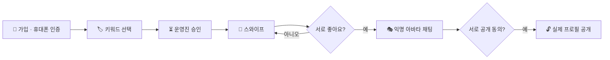

<div align="center">

### 💗 티가나 · 키워드로 먼저 만나는 익명 매칭 앱

 


<br/>


</div>

<br/>

> 📦 **프로젝트 기록용 레포예요.** 2025년 Google Play에 출시해 운영했던 앱으로, 현재는 서비스를 종료했어요.

## 💡 어떤 앱인가요?

사진 한 장으로 판단하는 소개팅 앱에 지쳤다면, **티가나**는 순서를 바꿔요.

처음에는 **얼굴 대신 키워드**로 서로를 알아가요. 좋아하는 영화, 자주 가는 장소, 나를 표현하는 한 단어.
대화가 잘 통하고 **두 사람이 모두 동의했을 때** 비로소 진짜 프로필이 공개돼요.

<br/>

## ✨ 주요 기능

| | 기능 | 설명 |
|:-:|---|---|
| 🏷️ | **키워드 프로필** | 대표 키워드 · 인생 영화 · 좋아하는 장소 · 자유 키워드로 나를 소개 |
| 🧩 | **4분할 그리드 프로필** | 원형 사진과 4칸 키워드 카드로 한눈에 보는 프로필 |
| 💌 | **스와이프 매칭** | 좋아요 / 넘기기, 서로 좋아요를 누르면 매칭 성사 🎉 |
| 🎭 | **익명 아바타 채팅** | 매칭 후 아바타로 먼저 대화 |
| 🔓 | **상호 동의 프로필 공개** | 두 사람이 모두 동의해야 실제 프로필 공개 |
| 💗 | **하트 크레딧** | 카카오페이로 충전하는 앱 내 크레딧 |
| 📱 | **휴대폰 인증 · 가입 승인** | 본인 인증 후 운영진 승인을 거쳐 활동 시작 |
| 🛠️ | **관리자 페이지** | 회원 · 결제 · 통계 관리 |

<br/>

## 🔄 매칭 흐름



<br/>

## 📁 프로젝트 구조

```
tigana/
├── 📱 app/                         # 티가나 앱 (풀스택 TypeScript)
│   ├── client/src/
│   │   ├── pages/                  # 홈 · 키워드 선택 · 프로필 설정 · 승인 대기 · 관리자
│   │   ├── components/             # 스와이프 카드 · 채팅 · 매칭 모달 · 계정 설정 …
│   │   │   └── ui/                 # shadcn/ui 공통 컴포넌트
│   │   ├── hooks/ · lib/ · contexts/
│   ├── server/
│   │   ├── index.ts                # Express 서버 시작점
│   │   ├── routes.ts               # 매칭 · 결제 · 관리자 API
│   │   ├── auth-routes.ts          # 회원가입 · 로그인 (bcrypt)
│   │   ├── storage.ts              # DB 접근 계층
│   │   └── db.ts
│   ├── shared/schema.ts            # 클라이언트 · 서버 공용 DB 스키마 (Drizzle + Zod)
│   ├── .env.example                # 환경 변수 예시
│   └── package.json …
└── 📄 docs/                        # 출시 당시 정책 페이지 · 구조 문서
    ├── index.html                  # 개인정보 처리방침
    ├── privacy-policy.html         # 개인정보 처리방침 (같은 내용, 링크 호환용)
    ├── delete-account.html         # 계정 삭제 요청 안내
    └── ARCHITECTURE.md             # 시스템 구조 상세 설명
```

<br/>

## 🚀 실행 방법

```bash
cd app

# 1. 라이브러리 설치
npm install

# 2. 환경 변수 설정 (.env.example을 복사해서 값 채우기)
cp .env.example .env

# 3. DB 테이블 생성
npm run db:push

# 4. 개발 서버 실행 → http://localhost:5000
npm run dev
```

| 명령어 | 설명 |
|---|---|
| `npm run dev` | 개발 서버 (프론트 + 백엔드 동시 실행) |
| `npm run build` | 배포용 빌드 |
| `npm run start` | 빌드 결과 실행 |
| `npm run db:push` | DB 스키마 반영 |

<br/>

## 📄 출시 당시 정책 문서

스토어 출시를 위해 직접 작성하고 운영했던 정책 페이지예요.

| 페이지 | 파일 |
|---|---|
| 🔒 개인정보 처리방침 | [`docs/privacy-policy.html`](docs/privacy-policy.html) |
| 🗑️ 계정 삭제 요청 안내 | [`docs/delete-account.html`](docs/delete-account.html) |


